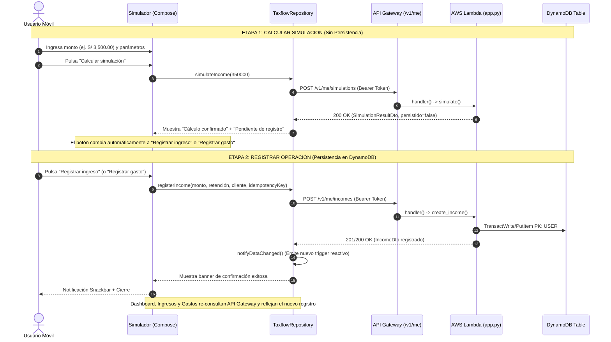

# Especificación Técnica de Integración: Registro de Ingresos y Gastos en AWS

**Documento para:** Agente 2 (AWS - Lambda, API Gateway & DynamoDB)  
**Preparado por:** Agente 1 (Android - Frontend, MVVM & HTTP Client)  
**Proyecto:** TaxFlow Mobile (Prototipo Académico - SUNAT 4ta Categoría)  
**Fecha:** Octubre 2026  
**Versión de API:** v2.0  
**Ubicación:** `docs/integration/REGISTRO_INGRESOS_GASTOS_AWS.md`

---

## A. Contexto Funcional

### 1. Flujo Anterior (Solo Simulación)
Anteriormente, el usuario abría el simulador tributario, elegía *Ingreso (RHE)* o *Gasto deducible*, ingresaba un monto y pulsaba *"Calcular Simulación en AWS"*. La app consultaba `POST /v1/me/simulations`, mostraba el resultado matemático calculado por AWS Lambda y presentaba el botón *"Recalcular en AWS"*. No existía persistencia en DynamoDB; los datos eran efímeros y no se reflejaban en el Dashboard ni en los listados de comprobantes.

### 2. Nuevo Flujo en Dos Etapas (Cálculo ➔ Registro)
Para el prototipo académico se implementa una separación rigurosa entre **Simular** y **Persistir**:



---

## B. Estado de los Endpoints Existentes

| Endpoint | Método | Estado Backend (AWS) | Consumo en Android | Comportamiento Actual |
|---|---|:---:|:---:|---|
| `/v1/auth/login` | `POST` | **Desplegado / Funcional** |  Confirmado en código | Genera token Bearer de 256 bits y retorna `ProfileDto`. |
| `/v1/auth/register` | `POST` | **Desplegado / Funcional** |  Confirmado en código | Registra usuario nuevo con perfil en blanco. |
| `/v1/auth/logout` | `POST` | **Desplegado / Funcional** |  Confirmado en código | Invalida sesión (requiere cuerpo JSON `{}`). |
| `/v1/me` | `GET` | **Desplegado / Funcional** |  Confirmado en código | Retorna perfil del usuario activo. |
| `/v1/me/dashboard` | `GET` | **Desplegado / Funcional** |  Confirmado en código | Calcula KPIs agregando dinámicamente registros de DynamoDB. |
| `/v1/me/incomes` | `GET` | **Desplegado / Funcional** |  Confirmado en código | Lista RHEs emitidos filtrados por fecha/estado. |
| `/v1/me/incomes/{id}` | `GET` | **Desplegado / Funcional** |  Confirmado en código | Detalle individual de un comprobante de ingreso. |
| `/v1/me/expenses` | `GET` | **Desplegado / Funcional** |  Confirmado en código | Lista gastos deducibles registrados. |
| `/v1/me/expenses/{id}` | `GET` | **Desplegado / Funcional** |  Confirmado en código | Detalle individual de un comprobante de gasto. |
| `/v1/me/calendar` | `GET` | **Desplegado / Funcional** |  Confirmado en código | Cronograma SUNAT según último dígito de RUC. |
| `/v1/me/notifications` | `GET` | **Desplegado / Funcional** |  Confirmado en código | Lista de notificaciones tributarias. |
| `/v1/me/simulations` | `POST` | **Desplegado / Funcional** |  Confirmado en código | Cálculo matemático en la nube (`persistido: false`). |
| `/v1/me/incomes` | `POST` | ⚠️ **PENDIENTE EN AWS** | ⏳ **Preparado en Android** | Responde `404 NOT_FOUND` (Ruta no implementada en `app.py`). |
| `/v1/me/expenses` | `POST` | ⚠️ **PENDIENTE EN AWS** | ⏳ **Preparado en Android** | Responde `404 NOT_FOUND` (Ruta no implementada en `app.py`). |

---

## C. Contrato REST Requerido para Registro

### 1. Registrar Ingreso (RHE)
* **Ruta:** `POST /v1/me/incomes`
* **Cabecera Requerida:** `Authorization: Bearer <token>`
* **Content-Type:** `application/json`
* **Idempotencia:** Cabecera opcional `X-Idempotency-Key` o campo `idempotency_key` en el cuerpo JSON.

#### Campos de Solicitud (Request):
| Campo | Tipo | Requerido | Descripción | Ejemplo |
|---|---|:---:|---|---|
| `monto_bruto_centimos` | Integer (Long) | Sí | Monto en céntimos de sol (mínimo 100 = S/ 1.00). | `350000` |
| `aplicar_retencion` | Boolean | Sí | Indica si aplica la retención SUNAT del 8% (> S/ 1,500). | `true` |
| `cliente` | String | No | Nombre o razón social del cliente (mín. 1, máx. 150 caracteres). | `"Empresa Consultora S.A.C."` |
| `fecha` | String | No | Fecha de emisión en formato `YYYY-MM-DD` (default: fecha actual). | `"2026-09-20"` |
| `serie` | String | No | Serie del recibo (default: `"E001"`). | `"E001"` |
| `numero` | String | No | Número correlativo (si no se envía, Lambda autogenera). | `"0046"` |
| `idempotency_key` | String (UUID) | No | Clave de idempotencia para prevenir duplicados ante reintentos. | `"b4a2c5e1-8273-4f91-92b0-84a1d743a129"` |

#### Campos de Respuesta (Response HTTP 201 o 200):
Retorna el objeto `IncomeDto` completo persistido:
```json
{
  "id": "inc-2026-0046",
  "cliente": "Empresa Consultora S.A.C.",
  "serie": "E001",
  "numero": "0046",
  "fecha": "2026-09-20",
  "monto_bruto_centimos": 350000,
  "retencion_centimos": 28000,
  "monto_neto_centimos": 322000,
  "estado": "PAGADO",
  "origen": "SIMULADOR_APP"
}
```

---

### 2. Registrar Gasto Deducible
* **Ruta:** `POST /v1/me/expenses`
* **Cabecera Requerida:** `Authorization: Bearer <token>`
* **Content-Type:** `application/json`

#### Campos de Solicitud (Request):
| Campo | Tipo | Requerido | Descripción | Ejemplo |
|---|---|:---:|---|---|
| `monto_centimos` | Integer (Long) | Sí | Monto total pagado en céntimos (mínimo 100 = S/ 1.00). | `18500` |
| `categoria` | String | Sí | `"restaurantes"`, `"servicios"`, `"alojamiento"`, `"essalud"`. | `"restaurantes"` |
| `proveedor` | String | No | Establecimiento o emisor del comprobante (máx. 150 car.). | `"Restaurante El Sol"` |
| `fecha` | String | No | Fecha del comprobante en formato `YYYY-MM-DD`. | `"2026-09-20"` |
| `serie` | String | No | Serie del comprobante (default: `"B001"`). | `"B001"` |
| `numero` | String | No | Número correlativo (autogenerado por backend si es nulo). | `"0234"` |
| `idempotency_key` | String (UUID) | No | Clave de idempotencia para reintentos seguros. | `"9fa3b1d0-1122-48a3-89ef-31cb54ae8891"` |

#### Campos de Respuesta (Response HTTP 201 o 200):
Retorna el objeto `ExpenseDto` completo persistido:
```json
{
  "id": "exp-2026-0234",
  "proveedor": "Restaurante El Sol",
  "serie": "B001",
  "numero": "0234",
  "fecha": "2026-09-20",
  "categoria": "restaurantes",
  "monto_centimos": 18500,
  "porcentaje_deducible_pb": 1500,
  "deducible_centimos": 2775,
  "estado": "MANUAL",
  "origen": "SIMULADOR_APP"
}
```

---

## D. Ejemplos JSON de Casos Límite y Errores

### 1. Error de Validación (HTTP 400 - Monto Inválido o Faltante)
```json
// POST /v1/me/incomes con monto negativo o ausente
{
  "error": {
    "code": "VALIDATION_ERROR",
    "message": "monto_bruto_centimos debe ser un entero positivo mayor a 0",
    "request_id": "7fa12b9c-8a12-4091-a129-bc89ef234012"
  }
}
```

### 2. Error de Categoría de Gasto Desconocida (HTTP 400)
```json
// POST /v1/me/expenses con categoria "combustible"
{
  "error": {
    "code": "VALIDATION_ERROR",
    "message": "Categoria invalida. Permitidas: restaurantes, servicios, alojamiento, essalud",
    "request_id": "81ab92c0-8271-48af-9102-ac48ef991023"
  }
}
```

### 3. Registro Duplicado / Reintento Idempotente (HTTP 200 - Idempotencia)
Si el cliente envía una petición con la misma `idempotency_key` dentro de la ventana de sesión, el backend Lambda **debe devolver el registro previamente creado con HTTP 200**, sin insertar un segundo registro en DynamoDB ni duplicar montos en el Dashboard.

Si se detecta un conflicto por clave primaria natural duplicada (ej. misma serie y número):
```json
{
  "error": {
    "code": "DUPLICATE_OPERATION",
    "message": "Ya existe un comprobante registrado con la serie E001 y número 0046",
    "request_id": "1829cb81-98aa-4190-b182-cd89fa123001"
  }
}
```

---

## E. Persistencia en Amazon DynamoDB (Single-Table Design)

De acuerdo a la arquitectura observada en `repository.py` y `service.py`, la tabla DynamoDB utiliza el patrón **Single-Table Design**:

### 1. Claves y Estructura para Ingresos (`INCOME`)
* **Partition Key (PK):** `USER#<user_id>` (ej. `USER#demo-01`)
* **Sort Key (SK):** `INCOME#<id>` (ej. `INCOME#inc-2026-0046` o `INCOME#<uuid>`)
* **Atributos:**
  * `id`: `<identificador>`
  * `cliente`: `<string>`
  * `serie`: `<string>`
  * `numero`: `<string>`
  * `fecha`: `YYYY-MM-DD`
  * `monto_bruto_centimos`: `<number>`
  * `retencion_centimos`: `<number>` (calculado por Lambda con `rules['retencion_pb']`)
  * `monto_neto_centimos`: `<number>` (`monto_bruto_centimos - retencion_centimos`)
  * `estado`: `"PAGADO"`
  * `origen`: `"SIMULADOR_APP"`
  * `idempotency_key`: `<uuid>`

### 2. Claves y Estructura para Gastos (`EXPENSE`)
* **Partition Key (PK):** `USER#<user_id>` (ej. `USER#demo-01`)
* **Sort Key (SK):** `EXPENSE#<id>` (ej. `EXPENSE#exp-2026-0234` o `EXPENSE#<uuid>`)
* **Atributos:**
  * `id`: `<identificador>`
  * `proveedor`: `<string>`
  * `serie`: `<string>`
  * `numero`: `<string>`
  * `fecha`: `YYYY-MM-DD`
  * `categoria`: `<string>`
  * `monto_centimos`: `<number>`
  * `porcentaje_deducible_pb`: `<number>` (ej. `1500` para restaurantes, `3000` para servicios)
  * `deducible_centimos`: `<number>` (calculado por Lambda con `rules['categorias_pb']`)
  * `estado`: `"MANUAL"`
  * `origen`: `"SIMULADOR_APP"`
  * `idempotency_key`: `<uuid>`

> **Impacto Automático en el Dashboard:**  
> En `service.py`, la función `dashboard(user, month)` ya realiza consultas mediante `self.repo.query(user, 'INCOME')` y `self.repo.query(user, 'EXPENSE')` y recalcula en tiempo de lectura `ingresos_anio_centimos`, `gastos_anio_centimos`, `deducible_anio_centimos` y `actividad_reciente`. Al insertar los ítems con el prefijo `INCOME#` y `EXPENSE#` bajo la clave `USER#<user_id>`, **el Dashboard reflejará los nuevos valores inmediatamente**.

---

## F. Validaciones y Reglas del Backend (AWS Lambda)

1. **Autenticación Obligatoria:** Rechazar con `401 INVALID_CREDENTIALS` cualquier petición sin cabecera `Authorization: Bearer <token>` válida.
2. **Separación Estricta por Usuario:** El `user_id` se extrae exclusivamente del token validado en la sesión. La partición de DynamoDB siempre debe ser `USER#<user_id>`, garantizando aislamiento total entre `demo-01`, `demo-02` y `demo-03`.
3. **Cálculo de Retenciones en el Backend:** La app envía `monto_bruto_centimos` y `aplicar_retencion: Boolean`. Lambda debe validar y calcular `retencion_centimos` usando las reglas tributarias maestras (`DEMO#RULES#demo-v1`), sin confiar a ciegas en cálculos previos del cliente.
4. **Cálculo de Deducciones en el Backend:** Lambda debe computar `deducible_centimos` aplicando el porcentaje de puntos básicos (`categorias_pb`) configurado en DynamoDB.
5. **Manejo de Idempotencia:** Guardar temporalmente `idempotency_key` para responder la misma entidad en caso de doble pulsación o timeout de red.

---

## G. Implementación Realizada en la Aplicación Android

La aplicación móvil ya cuenta con todos los componentes listos para consumir los endpoints cuando el agente AWS los despliegue:

* **Servicio HTTP ([`TaxflowApiService.kt`](file:///C:/Github/Taxflow_Movil/app/src/main/java/com/gmaldonado/taxflow_movil/data/remote/TaxflowApiService.kt)):**
  * `registerIncome(RegisterIncomeRequest): IncomeDto` (`POST /v1/me/incomes`)
  * `registerExpense(RegisterExpenseRequest): ExpenseDto` (`POST /v1/me/expenses`)
* **Repositorio ([`TaxflowRepository.kt`](file:///C:/Github/Taxflow_Movil/app/src/main/java/com/gmaldonado/taxflow_movil/data/repository/TaxflowRepository.kt)):**
  * Métodos `registerIncome` y `registerExpense` con manejo de idempotencia y fechas por defecto.
  * `dataRefreshTrigger: StateFlow<Int>`: emite notificaciones reactivas de cambio tras cada registro exitoso.
* **Componente de Interfaz ([`SimulatorBottomSheet.kt`](file:///C:/Github/Taxflow_Movil/app/src/main/java/com/gmaldonado/taxflow_movil/ui/components/SimulatorBottomSheet.kt)):**
  * Máquina de estados: `Inicial ➔ Calculando ➔ Calculado ("Pendiente de registro") ➔ Registrando ➔ Registrado`.
  * Invalidación automática de cálculo si el usuario altera monto, retención, categoría o pestaña.
  * Bloqueo contra doble pulsación (`enabled = !isRegistering`).
  * Textos amigables conforme a la especificación de UX.
  * Manejo transparente de HTTP 404 informando que la ruta está pendiente de despliegue en AWS sin borrar el cálculo simulado.
* **Actualización Reactiva de Pantallas:**
  * [`DashboardScreen.kt`](file:///C:/Github/Taxflow_Movil/app/src/main/java/com/gmaldonado/taxflow_movil/ui/screens/DashboardScreen.kt), [`IngresosScreen.kt`](file:///C:/Github/Taxflow_Movil/app/src/main/java/com/gmaldonado/taxflow_movil/ui/screens/IngresosScreen.kt) y [`GastosScreen.kt`](file:///C:/Github/Taxflow_Movil/app/src/main/java/com/gmaldonado/taxflow_movil/ui/screens/GastosScreen.kt) observan `dataRefreshTrigger` y re-consultan automáticamente `/v1/me/...` al confirmar un registro.

---

## H. Matriz de Responsabilidades

| Tarea / Componente | Agente 1 (Android) | Agente 2 (AWS) |
|---|:---:|:---:|
| Interfaz y Bottom Sheet con textos corregidos |  **Completado** | N/A |
| Máquina de estados (Calcular ➔ Registrar) |  **Completado** | N/A |
| Invalidación reactiva ante cambios en inputs |  **Completado** | N/A |
| DTOs y llamadas HTTP Retrofit |  **Completado** | N/A |
| Re-consulta y actualización del Dashboard |  **Completado** | N/A |
| Documento de integración técnica |  **Completado** | N/A |
| Manejo de ruta `POST /v1/me/incomes` en `app.py` / `service.py` | N/A | ⏳ **Pendiente** |
| Manejo de ruta `POST /v1/me/expenses` en `app.py` / `service.py` | N/A | ⏳ **Pendiente** |
| Inserción de ítems en DynamoDB (`INCOME#`, `EXPENSE#`) | N/A | ⏳ **Pendiente** |
| Actualización del contrato `openapi.json` | N/A | ⏳ **Pendiente** |
