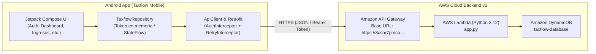

# Integración con API REST en AWS (Backend v2) - TaxFlow Mobile

Este documento describe la arquitectura, endpoints, modelos de datos y flujo de autenticación implementados en **TaxFlow Mobile** para conectarse con la API REST serverless desplegada en **AWS (API Gateway + AWS Lambda + DynamoDB)** según el contrato OpenAPI v2.

---

## 1. Arquitectura de Integración Serverless



* **Base URL**: `https://8cspr7pmca.execute-api.us-east-1.amazonaws.com`
* **Estándar de Contrato**: OpenAPI 3.0.3 (`docs/openapi.json` en `Taxflow_DB`)
* **Autenticación**: Cabecera HTTP `Authorization: Bearer <token_opaco_256_bits>`
* **Duración de Sesión**: 7,200 segundos (2 horas)

---

## 2. Endpoints Implementados

### Autenticación (`/v1/auth/*`)

| Método | Endpoint | Request Body | Headers | Descripción |
|---|---|---|---|---|
| `POST` | `/v1/auth/login` | `{"email": "...", "password": "..."}` | `Content-Type: application/json` | Inicia sesión y genera token de sesión opaco (256 bits). |
| `POST` | `/v1/auth/register` | `{"nombre": "...", "email": "...", "password": "..."}` | `Content-Type: application/json` | Registra un nuevo usuario independiente. |
| `POST` | `/v1/auth/logout` | `{}` | `Authorization: Bearer <token>` | Invalida el token en DynamoDB y cierra sesión. |

### Rutas de Usuario y Métricas (`/v1/me/*`)

Todas estas rutas requieren la cabecera `Authorization: Bearer <token>`:

| Método | Endpoint | Query Params | Descripción |
|---|---|---|---|
| `GET` | `/v1/me` | Ninguno | Retorna el perfil del usuario autenticado (`ProfileDto`). |
| `GET` | `/v1/me/dashboard` | `anio=2026&mes=9` | Retorna KPIs del dashboard: ingresos acumulados, límite 7 UIT, proyección y vencimiento SUNAT. |
| `GET` | `/v1/me/incomes` | `anio=2026` | Listado de comprobantes RHE emitidos en el año fiscal. |
| `POST` | `/v1/me/incomes` | `RegisterIncomeRequest` | Registra y persiste un RHE emitido en DynamoDB (asociado al usuario autenticado). |
| `GET` | `/v1/me/expenses` | `anio=2026` | Listado de gastos deducibles registrados en el año (tope 3 UIT). |
| `POST` | `/v1/me/expenses` | `RegisterExpenseRequest` | Registra y persiste un gasto deducible en DynamoDB (asociado al usuario autenticado). |
| `GET` | `/v1/me/calendar` | `anio=2026&mes=9` | Cronograma de obligaciones tributarias según el último dígito del RUC. |
| `POST` | `/v1/me/simulations` | `SimulationRequest` | Cálculo tributario en la nube en tiempo real (sin persistencia). |

> 📌 Para la especificación técnica completa dirigida al equipo backend/AWS, consulta: [`docs/integration/REGISTRO_INGRESOS_GASTOS_AWS.md`](../docs/integration/REGISTRO_INGRESOS_GASTOS_AWS.md).

---

## 3. Manejo de Autenticación y Tokens

### Interceptor de Autenticación (`ApiClient.kt`)

El cliente HTTP (`OkHttpClient`) cuenta con dos interceptores esenciales:

1. **`authInterceptor`**: Intercepta toda petición saliente. Si existe un token activo provisto por `TaxflowRepository.getAuthToken()`, inyecta automáticamente el encabezado:
   ```http
   Authorization: Bearer <token>
   ```
2. **`RateLimitRetryInterceptor`**: Gestiona códigos HTTP `429 Too Many Requests` aplicando reintentos automáticos con retroceso exponencial.
3. **Manejo de Cold Starts de AWS Lambda**: Los timeouts de conexión y lectura se establecieron en **30 segundos** para tolerar de forma transparente la inicialización de contenedores Lambda en frío (~6s a ~12s).

---

## 4. Modelos de Datos (Kotlin DTOs)

### `ProfileDto`
Representa al usuario autenticado. `ultimo_digito_ruc` es nullable (`Int?`), ya que los usuarios nuevos recién registrados nacen con RUC pendiente de configuración:

```kotlin
data class ProfileDto(
    @SerializedName("user_id") val userId: String,
    @SerializedName("nombre") val nombre: String,
    @SerializedName("email") val email: String,
    @SerializedName("ruc") val ruc: String? = null,
    @SerializedName("ultimo_digito_ruc") val ultimoDigitoRuc: Int? = null,
    @SerializedName("profesion") val profesion: String? = null,
    @SerializedName("avatar_url") val avatarUrl: String? = null,
    @SerializedName("created_at") val createdAt: String? = null
)
```

### `SessionResponse`
Respuesta emitida por `/v1/auth/login` y `/v1/auth/register`:

```kotlin
data class SessionResponse(
    @SerializedName("token") val token: String,
    @SerializedName("expires_in") val expiresIn: Long = 7200,
    @SerializedName("profile") val profile: ProfileDto
)
```

---

## 5. Cuentas Pre-cargadas para Pruebas (Seed DynamoDB)

Para facilitar la demostración y verificación rápida en el entorno móvil, la pantalla de autenticación (`AuthScreen.kt`) incluye tarjetas de acceso rápido con credenciales de prueba pre-cargadas en DynamoDB:

| Usuario | Email | Contraseña | RUC | Último Dígito | Ingresos Acumulados |
|---|---|---|---|---|---|
| **Carlos Jara** | `carlos.jara@taxflow.pe` | `DemoPass2026!A` | `10458796321` | `1` | S/ 28,200.00 |
| **Carmen González** | `carmen.gonzalez@taxflow.pe` | `DemoPass2026!B` | `10234567894` | `4` | S/ 15,400.00 |
| **Óscar Paredes** | `oscar.paredes@taxflow.pe` | `DemoPass2026!C` | `10789456128` | `8` | S/ 38,900.00 |

Adicionalmente, se pueden registrar cuentas nuevas usando la pestaña **Registrarse**; dichas cuentas inician con un perfil limpio y contadores en cero.

---

## 6. Pruebas y Verificación

La integración ha sido completamente verificada en el emulador Android de desarrollo:
- Inicio de sesión con autenticación Bearer (`HTTP 200`).
- Carga de Dashboard con métricas de 4ta categoría en tiempo real (`HTTP 200`).
- Listado de Recibos por Honorarios (`HTTP 200`).
- Listado de Gastos Deducibles (`HTTP 200`).
- Cronograma SUNAT filtrado por dígito de RUC (`HTTP 200`).
- Ejecución de simulación de RHE en AWS Lambda (`POST /v1/me/simulations`, `HTTP 200`).
- Persistencia real de Recibo por Honorarios en DynamoDB (`POST /v1/me/incomes`, `HTTP 201`).
- Persistencia real de Gasto Deducible en DynamoDB (`POST /v1/me/expenses`, `HTTP 201`).
- Flujo en dos etapas en el Simulador Tributario con invalidación reactiva e idempotencia (UUID v4).
- Sincronización automática de métricas en Dashboard, Ingresos y Gastos tras el registro mediante `TaxflowRepository.dataRefreshTrigger`.
- Cierre de sesión e invalidación de token con body vacío `{}` (`HTTP 200`).

