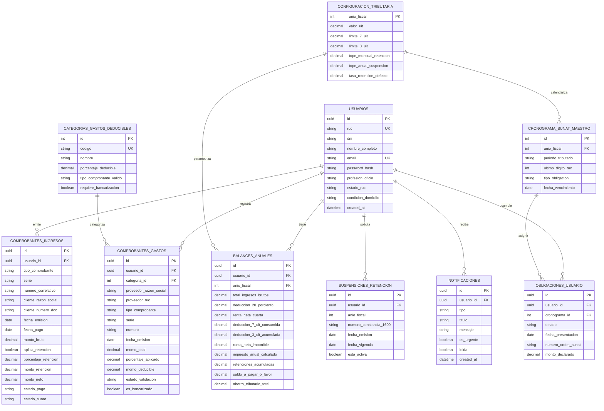

# Modelo y Esquema de Base de Datos: TaxFlow Mobile (SUNAT 4ta Categoría)

Este documento detalla el modelo de datos relacional y la arquitectura de almacenamiento necesaria para dar soporte completo a la aplicación **TaxFlow Mobile** (Rentas de 4ta categoría para profesionales independientes, emisión de RHE, control del escudo tributario de 7 UIT, gastos deducibles de 3 UIT, calendario fiscal SUNAT y simulador tributario).

---

## 1. Arquitectura de Datos

El sistema está diseñado bajo un enfoque híbrido **Offline-First**:
* **Base de Datos Cloud / Backend**: PostgreSQL (compatible con Supabase, AWS RDS o servidores dedicados) para la sincronización centralizada, autenticación y persistencia de comprobantes.
* **Base de Datos Local (Android)**: SQLite a través de **Android Jetpack Room** en la aplicación móvil, garantizando disponibilidad y cálculo de métricas tributarias incluso sin conexión a internet.

---

## 2. Diagrama Entidad-Relación (ERD)



---

## 3. Diccionario de Datos

### 3.1. `usuarios` (Contribuyente 4ta Categoría)
Almacena el perfil del profesional independiente (*ej. Carlos Mendoza Ramos*).
* `id` (`UUID`, PK): Identificador único.
* `ruc` (`VARCHAR(11)`, UNIQUE): RUC persona natural con negocio o profesión (inicia en `10`).
* `dni` (`VARCHAR(8)`): Documento Nacional de Identidad.
* `nombre_completo` (`VARCHAR(150)`): Como figura en RENIEC / DNI.
* `email` (`VARCHAR(100)`, UNIQUE): Correo para autenticación y avisos.
* `password_hash` (`VARCHAR(255)`): Contraseña cifrada (Argon2id o BCrypt).
* `profesion_oficio` (`VARCHAR(100)`): Ocupación declarada (*ej. Diseñador UI/UX*).
* `estado_ruc` (`VARCHAR(20)`): Estado en SUNAT (*ACTIVO*, *SUSPENDIDO*, *BAJA*).
* `condicion_domicilio` (`VARCHAR(20)`): Condición fiscal (*HABIDO*, *NO HABIDO*).
* `created_at` (`TIMESTAMP`): Fecha de registro.
* `updated_at` (`TIMESTAMP`): Fecha de última actualización.

### 3.2. `configuracion_tributaria` (Parámetros Anuales SUNAT)
Centraliza los valores anuales de la UIT y límites legales de deducción.
* `anio_fiscal` (`INT`, PK): Año de ejercicio gravable (*ej. 2026*).
* `valor_uit` (`DECIMAL(10,2)`): Valor oficial de la UIT fijado por el MEF (*ej. S/ 5,150.00*).
* `limite_7_uit` (`DECIMAL(10,2)`): Calculado como `valor_uit * 7` (S/ 36,050.00).
* `limite_3_uit` (`DECIMAL(10,2)`): Calculado como `valor_uit * 3` (S/ 15,450.00).
* `tope_mensual_retencion` (`DECIMAL(10,2)`): Monto límite mensual para retención del 8% (S/ 1,500.00 por comprobante o S/ 3,755.00 mensual).
* `tope_anual_suspension` (`DECIMAL(10,2)`): Monto anual máximo para solicitar Formulario 1609.
* `tasa_retencion_defecto` (`DECIMAL(5,2)`): 8.00%.

### 3.3. `categorias_gastos_deducibles` (Rubros del Decreto Legislativo 3 UIT)
Catálogo de los rubros admitidos por SUNAT para la deducción adicional:
* `id` (`INT`, PK): Identificador secuencial.
* `codigo` (`VARCHAR(30)`, UNIQUE): `RESTAURANTES_HOTELES`, `SERVICIOS_MEDICOS`, `SERVICIOS_PROFESIONALES`, `ESSALUD_HOGAR`, `ARRENDAMIENTO`.
* `nombre` (`VARCHAR(100)`): Nombre descriptivo (*ej. Restaurantes y Bares*).
* `porcentaje_deducible` (`DECIMAL(5,2)`): Porcentaje que se deduce del total (15.00%, 30.00%, 100.00%).
* `tipo_comprobante_valido` (`VARCHAR(50)`): `BOLETA_ELECTRONICA`, `RHE`, `FORMULARIO_1676`.
* `requiere_bancarizacion` (`BOOLEAN`): Si requiere comprobante de pago bancario (montos $\ge$ S/ 2,000 o \$500).
* `icono_identificador` (`VARCHAR(50)`): Nombre del icono Material en la app móvil.

### 3.4. `comprobantes_ingresos` (Recibos por Honorarios Electrónicos - RHE)
Almacena todos los comprobantes emitidos por el usuario (pantalla *Mis Ingresos*).
* `id` (`UUID`, PK).
* `usuario_id` (`UUID`, FK `usuarios.id`).
* `tipo_comprobante` (`VARCHAR(20)`): Por defecto `RHE`.
* `serie` (`VARCHAR(4)`): *Ej. E001*.
* `numero_correlativo` (`VARCHAR(10)`): *Ej. 48*.
* `cliente_razon_social` (`VARCHAR(150)`): Nombre o razón social del pagador.
* `cliente_tipo_doc` (`VARCHAR(10)`): `RUC` o `DNI`.
* `cliente_numero_doc` (`VARCHAR(11)`).
* `fecha_emision` (`DATE`).
* `fecha_pago` (`DATE`).
* `descripcion_servicio` (`TEXT`).
* `monto_bruto` (`DECIMAL(10,2)`): Monto total del servicio (*ej. S/ 4,500.00*).
* `aplica_retencion` (`BOOLEAN`): `TRUE` si hubo retención del 8%.
* `porcentaje_retencion` (`DECIMAL(5,2)`): 8.00% o 0.00%.
* `monto_retencion` (`DECIMAL(10,2)`): Calculado: `monto_bruto * 0.08` (*ej. S/ 360.00*).
* `monto_neto` (`DECIMAL(10,2)`): `monto_bruto - monto_retencion` (*ej. S/ 4,140.00*).
* `estado_pago` (`VARCHAR(20)`): `PAGADO`, `PENDIENTE`, `REVERTIDO`.
* `estado_sunat` (`VARCHAR(20)`): `VALIDADO`, `ANULADO`, `PENDIENTE_SINCRONIZACION`.
* `url_pdf` (`TEXT`): Enlace al comprobante digital generado en SUNAT Clave SOL.

### 3.5. `comprobantes_gastos` (Gastos Personales Deducibles)
Almacena los consumos registrados para la bolsa de 3 UIT (pantalla *Mis Gastos Deducibles*).
* `id` (`UUID`, PK).
* `usuario_id` (`UUID`, FK `usuarios.id`).
* `categoria_id` (`INT`, FK `categorias_gastos_deducibles.id`).
* `proveedor_razon_social` (`VARCHAR(150)`): *Ej. Restaurante Central SAC*.
* `proveedor_ruc` (`VARCHAR(11)`).
* `tipo_comprobante` (`VARCHAR(20)`): `BOLETA`, `FACTURA`, `RHE`, `FORMULARIO_1676`.
* `serie` (`VARCHAR(10)`): *Ej. B001*.
* `numero` (`VARCHAR(15)`): *Ej. 44910*.
* `fecha_emision` (`DATE`).
* `monto_total` (`DECIMAL(10,2)`): Monto pagado con DNI (*ej. S/ 320.00*).
* `porcentaje_aplicado` (`DECIMAL(5,2)`): Porcentaje del rubro (*ej. 15.00%*).
* `monto_deducible` (`DECIMAL(10,2)`): Monto computable para el escudo (*monto_total * 0.15 = S/ 48.00*).
* `estado_validacion` (`VARCHAR(20)`): `VALIDADO_SUNAT`, `OBSERVADO`, `MANUAL`.
* `es_bancarizado` (`BOOLEAN`).

### 3.6. `balances_anuales` (Escudo Tributario e Impuesto a la Renta)
Mantiene el consolidado y las métricas en tiempo real que se muestran en el *Dashboard*.
* `id` (`UUID`, PK).
* `usuario_id` (`UUID`, FK `usuarios.id`).
* `anio_fiscal` (`INT`, FK `configuracion_tributaria.anio_fiscal`).
* `total_ingresos_brutos` (`DECIMAL(12,2)`): Suma de RHE del año.
* `deduccion_20_porciento` (`DECIMAL(12,2)`): Deducción legal automática del 20% de los ingresos de 4ta (tope 24 UIT).
* `renta_neta_cuarta` (`DECIMAL(12,2)`): `total_ingresos_brutos - deduccion_20_porciento`.
* `deduccion_7_uit_consumida` (`DECIMAL(10,2)`): Hasta agotar los S/ 36,050.
* `deduccion_3_uit_acumulada` (`DECIMAL(10,2)`): Suma de `monto_deducible` de gastos (tope S/ 15,450).
* `renta_neta_imponible` (`DECIMAL(12,2)`): Base sobre la cual se calculan los tramos progresivos del IR.
* `impuesto_anual_calculado` (`DECIMAL(10,2)`): Impuesto anual antes de deducciones/créditos (*ej. S/ 2,140.00*).
* `retenciones_acumuladas` (`DECIMAL(10,2)`): Suma de retenciones del 8% sufridas.
* `saldo_a_pagar_o_favor` (`DECIMAL(10,2)`): Positivo = impuesto a pagar; negativo = saldo a favor de devolución.
* `ahorro_tributario_total` (`DECIMAL(10,2)`): Beneficio generado por las 3 UIT (*ej. +S/ 1,200.00*).

### 3.7. `cronograma_sunat_maestro` y `obligaciones_usuario`
Gestiona la pestaña *Calendario SUNAT*.
* Permite notificar cuándo vence el *Declara Fácil 616* según el último dígito del RUC (dígito 4 = día 18 de septiembre en el prototipo).
* Registra el estado: `PENDIENTE`, `PROXIMO_A_VENCER`, `PRESENTADO`.

### 3.8. `suspensiones_retencion`
Control del Formulario Virtual 1609. Si está activo, el simulador y los nuevos RHE omiten automáticamente la retención del 8%.

---

## 4. Script SQL DDL (PostgreSQL)

```sql
-- Habilitar extensión UUID
CREATE EXTENSION IF NOT EXISTS "uuid-ossp";

-- 1. CONFIGURACIÓN TRIBUTARIA ANUAL
CREATE TABLE configuracion_tributaria (
    anio_fiscal INT PRIMARY KEY,
    valor_uit DECIMAL(10, 2) NOT NULL,
    limite_7_uit DECIMAL(10, 2) GENERATED ALWAYS AS (valor_uit * 7) STORED,
    limite_3_uit DECIMAL(10, 2) GENERATED ALWAYS AS (valor_uit * 3) STORED,
    tope_mensual_retencion DECIMAL(10, 2) DEFAULT 1500.00,
    tope_anual_suspension DECIMAL(10, 2) NOT NULL,
    tasa_retencion_defecto DECIMAL(5, 2) DEFAULT 8.00,
    created_at TIMESTAMP WITH TIME ZONE DEFAULT CURRENT_TIMESTAMP
);

-- Datos iniciales 2026
INSERT INTO configuracion_tributaria (anio_fiscal, valor_uit, tope_anual_suspension)
VALUES (2026, 5150.00, 45063.00);

-- 2. USUARIOS / CONTRIBUYENTES
CREATE TABLE usuarios (
    id UUID PRIMARY KEY DEFAULT uuid_generate_v4(),
    ruc VARCHAR(11) NOT NULL UNIQUE,
    dni VARCHAR(8) NOT NULL,
    nombre_completo VARCHAR(150) NOT NULL,
    email VARCHAR(100) NOT NULL UNIQUE,
    password_hash VARCHAR(255) NOT NULL,
    profesion_oficio VARCHAR(100),
    estado_ruc VARCHAR(20) DEFAULT 'ACTIVO',
    condicion_domicilio VARCHAR(20) DEFAULT 'HABIDO',
    created_at TIMESTAMP WITH TIME ZONE DEFAULT CURRENT_TIMESTAMP,
    updated_at TIMESTAMP WITH TIME ZONE DEFAULT CURRENT_TIMESTAMP,
    CONSTRAINT chk_ruc_len CHECK (LENGTH(ruc) = 11)
);

CREATE INDEX idx_usuarios_ruc ON usuarios(ruc);

-- 3. CATEGORÍAS DE GASTOS DEDUCIBLES (3 UIT)
CREATE TABLE categorias_gastos_deducibles (
    id SERIAL PRIMARY KEY,
    codigo VARCHAR(30) NOT NULL UNIQUE,
    nombre VARCHAR(100) NOT NULL,
    porcentaje_deducible DECIMAL(5, 2) NOT NULL,
    tipo_comprobante_valido VARCHAR(50) NOT NULL,
    requiere_bancarizacion BOOLEAN DEFAULT FALSE,
    icono_identificador VARCHAR(50)
);

INSERT INTO categorias_gastos_deducibles (codigo, nombre, porcentaje_deducible, tipo_comprobante_valido, icono_identificador) VALUES
('RESTAURANTES_HOTELES', 'Restaurantes, Bares y Hoteles', 15.00, 'BOLETA_ELECTRONICA', 'restaurant'),
('SERVICIOS_MEDICOS', 'Servicios Médicos y Odontológicos', 30.00, 'RHE', 'stethoscope'),
('SERVICIOS_PROFESIONALES', 'Otros Servicios de 4ta Categoría', 30.00, 'RHE', 'engineering'),
('ESSALUD_HOGAR', 'Aportaciones EsSalud Trabajadores Hogar', 100.00, 'FORMULARIO_1676', 'volunteer_activism'),
('ARRENDAMIENTO', 'Alquiler de Inmuebles', 30.00, 'FACTURA_O_FORMULARIO_1683', 'home');

-- 4. COMPROBANTES DE INGRESO (RHE)
CREATE TABLE comprobantes_ingresos (
    id UUID PRIMARY KEY DEFAULT uuid_generate_v4(),
    usuario_id UUID NOT NULL REFERENCES usuarios(id) ON DELETE CASCADE,
    tipo_comprobante VARCHAR(20) DEFAULT 'RHE',
    serie VARCHAR(4) NOT NULL,
    numero_correlativo VARCHAR(10) NOT NULL,
    cliente_razon_social VARCHAR(150) NOT NULL,
    cliente_tipo_doc VARCHAR(10) DEFAULT 'RUC',
    cliente_numero_doc VARCHAR(11) NOT NULL,
    fecha_emision DATE NOT NULL,
    fecha_pago DATE,
    descripcion_servicio TEXT,
    monto_bruto DECIMAL(10, 2) NOT NULL,
    aplica_retencion BOOLEAN DEFAULT TRUE,
    porcentaje_retencion DECIMAL(5, 2) DEFAULT 8.00,
    monto_retencion DECIMAL(10, 2) NOT NULL,
    monto_neto DECIMAL(10, 2) NOT NULL,
    estado_pago VARCHAR(20) DEFAULT 'PAGADO',
    estado_sunat VARCHAR(20) DEFAULT 'VALIDADO',
    url_pdf TEXT,
    created_at TIMESTAMP WITH TIME ZONE DEFAULT CURRENT_TIMESTAMP,
    CONSTRAINT uq_serie_numero UNIQUE (usuario_id, serie, numero_correlativo)
);

CREATE INDEX idx_ingresos_usuario_fecha ON comprobantes_ingresos(usuario_id, fecha_emision DESC);

-- 5. COMPROBANTES DE GASTOS DEDUCIBLES
CREATE TABLE comprobantes_gastos (
    id UUID PRIMARY KEY DEFAULT uuid_generate_v4(),
    usuario_id UUID NOT NULL REFERENCES usuarios(id) ON DELETE CASCADE,
    categoria_id INT NOT NULL REFERENCES categorias_gastos_deducibles(id),
    proveedor_razon_social VARCHAR(150) NOT NULL,
    proveedor_ruc VARCHAR(11) NOT NULL,
    tipo_comprobante VARCHAR(20) NOT NULL,
    serie VARCHAR(10) NOT NULL,
    numero VARCHAR(15) NOT NULL,
    fecha_emision DATE NOT NULL,
    monto_total DECIMAL(10, 2) NOT NULL,
    porcentaje_aplicado DECIMAL(5, 2) NOT NULL,
    monto_deducible DECIMAL(10, 2) NOT NULL,
    estado_validacion VARCHAR(20) DEFAULT 'VALIDADO_SUNAT',
    es_bancarizado BOOLEAN DEFAULT FALSE,
    created_at TIMESTAMP WITH TIME ZONE DEFAULT CURRENT_TIMESTAMP
);

CREATE INDEX idx_gastos_usuario_cat ON comprobantes_gastos(usuario_id, categoria_id);

-- 6. BALANCES ANUALES
CREATE TABLE balances_anuales (
    id UUID PRIMARY KEY DEFAULT uuid_generate_v4(),
    usuario_id UUID NOT NULL REFERENCES usuarios(id) ON DELETE CASCADE,
    anio_fiscal INT NOT NULL REFERENCES configuracion_tributaria(anio_fiscal),
    total_ingresos_brutos DECIMAL(12, 2) DEFAULT 0.00,
    deduccion_20_porciento DECIMAL(12, 2) DEFAULT 0.00,
    renta_neta_cuarta DECIMAL(12, 2) DEFAULT 0.00,
    deduccion_7_uit_consumida DECIMAL(10, 2) DEFAULT 0.00,
    deduccion_3_uit_acumulada DECIMAL(10, 2) DEFAULT 0.00,
    renta_neta_imponible DECIMAL(12, 2) DEFAULT 0.00,
    impuesto_anual_calculado DECIMAL(10, 2) DEFAULT 0.00,
    retenciones_acumuladas DECIMAL(10, 2) DEFAULT 0.00,
    saldo_a_pagar_o_favor DECIMAL(10, 2) DEFAULT 0.00,
    ahorro_tributario_total DECIMAL(10, 2) DEFAULT 0.00,
    updated_at TIMESTAMP WITH TIME ZONE DEFAULT CURRENT_TIMESTAMP,
    CONSTRAINT uq_usuario_anio UNIQUE (usuario_id, anio_fiscal)
);

-- 7. CRONOGRAMA MAESTRO SUNAT
CREATE TABLE cronograma_sunat_maestro (
    id SERIAL PRIMARY KEY,
    anio_fiscal INT NOT NULL REFERENCES configuracion_tributaria(anio_fiscal),
    periodo_tributario VARCHAR(7) NOT NULL, -- Ej: '2026-08'
    ultimo_digito_ruc INT NOT NULL CHECK (ultimo_digito_ruc BETWEEN 0 AND 9),
    tipo_obligacion VARCHAR(50) NOT NULL, -- 'DECLARA_FACIL_616', 'DJ_ANUAL'
    fecha_vencimiento DATE NOT NULL,
    CONSTRAINT uq_periodo_digito UNIQUE (periodo_tributario, ultimo_digito_ruc, tipo_obligacion)
);

-- 8. OBLIGACIONES DEL USUARIO
CREATE TABLE obligaciones_usuario (
    id UUID PRIMARY KEY DEFAULT uuid_generate_v4(),
    usuario_id UUID NOT NULL REFERENCES usuarios(id) ON DELETE CASCADE,
    cronograma_id INT NOT NULL REFERENCES cronograma_sunat_maestro(id),
    estado VARCHAR(20) DEFAULT 'PENDIENTE', -- 'PENDIENTE', 'DECLARADO', 'VENCIDO'
    fecha_presentacion DATE,
    numero_orden_sunat VARCHAR(20),
    monto_declarado DECIMAL(10, 2),
    updated_at TIMESTAMP WITH TIME ZONE DEFAULT CURRENT_TIMESTAMP
);

-- 9. CONSTANCIAS DE SUSPENSIÓN (FV 1609)
CREATE TABLE suspensiones_retencion (
    id UUID PRIMARY KEY DEFAULT uuid_generate_v4(),
    usuario_id UUID NOT NULL REFERENCES usuarios(id) ON DELETE CASCADE,
    anio_fiscal INT NOT NULL,
    numero_constancia_1609 VARCHAR(20) NOT NULL,
    fecha_emision DATE NOT NULL,
    fecha_vigencia DATE NOT NULL,
    esta_activa BOOLEAN DEFAULT TRUE,
    url_constancia TEXT,
    created_at TIMESTAMP WITH TIME ZONE DEFAULT CURRENT_TIMESTAMP
);

-- 10. NOTIFICACIONES
CREATE TABLE notificaciones (
    id UUID PRIMARY KEY DEFAULT uuid_generate_v4(),
    usuario_id UUID NOT NULL REFERENCES usuarios(id) ON DELETE CASCADE,
    tipo VARCHAR(30) NOT NULL,
    titulo VARCHAR(120) NOT NULL,
    mensaje TEXT NOT NULL,
    es_urgente BOOLEAN DEFAULT FALSE,
    leida BOOLEAN DEFAULT FALSE,
    created_at TIMESTAMP WITH TIME ZONE DEFAULT CURRENT_TIMESTAMP
);
```

---

## 5. Mapeo para Android con Jetpack Room (Offline-First)

Para sincronizar y almacenar datos localmente en la app Android Studio, se estructuran las entidades de Room de la siguiente manera:

```kotlin
package com.gmaldonado.taxflow_movil.data.local

import androidx.room.Entity
import androidx.room.PrimaryKey
import java.util.UUID

// Entidad: Recibo por Honorarios Electrónico (RHE)
@Entity(tableName = "comprobantes_ingresos")
data class ComprobanteIngresoEntity(
    @PrimaryKey val id: String = UUID.randomUUID().toString(),
    val serie: String,
    val numeroCorrelativo: String,
    val clienteRazonSocial: String,
    val clienteNumeroDoc: String,
    val fechaEmision: String,
    val montoBruto: Double,
    val aplicaRetencion: Boolean,
    val montoRetencion: Double,
    val montoNeto: Double,
    val estadoPago: String,
    val estadoSunat: String
)

// Entidad: Gasto Deducible (3 UIT)
@Entity(tableName = "comprobantes_gastos")
data class ComprobanteGastoEntity(
    @PrimaryKey val id: String = UUID.randomUUID().toString(),
    val categoriaCodigo: String,
    val proveedorRazonSocial: String,
    val proveedorRuc: String,
    val tipoComprobante: String,
    val serie: String,
    val numero: String,
    val fechaEmision: String,
    val montoTotal: Double,
    val porcentajeAplicado: Double,
    val montoDeducible: Double,
    val estadoValidacion: String
)

// Entidad: Consolidado Anual del Escudo Tributario
@Entity(tableName = "balances_anuales")
data class BalanceAnualEntity(
    @PrimaryKey val anioFiscal: Int,
    val totalIngresosBrutos: Double,
    val deduccion7UitConsumida: Double,
    val deduccion3UitAcumulada: Double,
    val impuestoEstimadoAnual: Double,
    val ahorroTributarioTotal: Double
)

// Entidad: Obligación del Calendario SUNAT
@Entity(tableName = "obligaciones_sunat")
data class ObligacionSunatEntity(
    @PrimaryKey val id: String = UUID.randomUUID().toString(),
    val codigoFormulario: String,
    val titulo: String,
    val fechaVencimiento: String,
    val estado: String,
    val esUrgente: Boolean,
    val detalle: String
)
```

---

## 6. Reglas de Cálculo y Fórmulas Tributarias (SUNAT)

1. **Retención del 8% de 4ta Categoría**:
   $$\text{Retención} = \begin{cases} \text{Monto Bruto} \times 0.08 & \text{si Monto Bruto} > \text{S/ 1,500.00 y no cuenta con suspensión activa} \\ 0 & \text{en caso contrario} \end{cases}$$

2. **Deducción de Gastos 3 UIT**:
   $$\text{Monto Deducible} = \text{Monto Total del Comprobante} \times \text{Porcentaje del Rubro}$$
   *Sujeto al límite acumulado anual de:*
   $$\sum \text{Monto Deducible} \le 3 \times \text{UIT (S/ 15,450.00 en 2026)}$$

3. **Escala Progresiva Acumulativa del Impuesto a la Renta de Trabajo**:
   | Tramo en UIT | Tasa Aplicable |
   | :--- | :---: |
   | Hasta 5 UIT | 8% |
   | Más de 5 hasta 20 UIT | 14% |
   | Más de 20 hasta 35 UIT | 17% |
   | Más de 35 hasta 45 UIT | 20% |
   | Más de 45 UIT | 30% |
